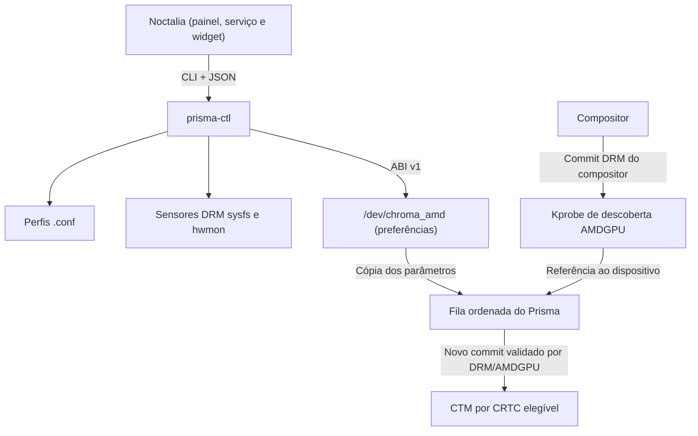

# Arquitetura e Mapa do Sistema (prisma)

O **Prisma Control Center** (`chroma-layer` / `prism-amd`) é uma suíte integrada de controle de cor e exibição em hardware projetada para GPUs AMD Radeon (`amdgpu`) no Linux, com foco no ambiente **Noctalia Shell (Niri / Wayland)**.

Este documento detalha as três camadas do sistema, o inventário completo de arquivos do repositório, o contrato oficial de integração JSON e o roteiro de evolução técnica.

---

## 1. Camadas do Sistema



### 1.1. Camada de kernel

`drm_atomic_helper_commit()` recebe um estado que já passou pela validação atômica. O Kprobe verifica se o dispositivo AMDGPU anunciado tem CTM, incrementa referências do DRM e do módulo do driver, e agenda trabalho. A sonda usa trylock sobre um spinlock bruto para a lista e os slots de descoberta. IRQ work sinaliza a fila quando o breakpoint roda com contexto NMI. A referência retida é a do dispositivo. A fila ordenada aloca os registros por dispositivo em contexto de processo. Um novo commit do compositor pode repetir uma descoberta descartada por falta de memória ou por lotação temporária dos slots.

O dispositivo de caractere usa ABI v1 com leitura textual, `GET_ABI`, `GET_STATE` e `SET_STATE`. Escritas textuais parciais preservam os campos omitidos e são validadas integralmente sob o mutex de configuração. As leituras por ioctl recebem uma única cópia coerente. Sysfs expõe os campos individuais em modo de leitura.

A fila calcula a matriz Rec.709 em S31.32 por aritmética inteira. O ganho de brilho varia entre 0,25× e 1,75×. Para cada CRTC ativo com propriedade CTM, o módulo obtém o lock de modeset, lê o blob atual e avalia a propriedade. Só assume um CRTC sem CTM. Cria um novo estado atômico, marca `color_mgmt_changed` e chama `drm_atomic_commit()`, com tratamento de `-EDEADLK` e sem permitir mudança de modo. O driver valida o novo estado antes de programá-lo. A confirmação de sucesso transfere uma referência ao registro daquele CRTC.

Ao desativar ou usar parâmetros neutros, o workqueue restaura bypass somente nos CRTCs em que a referência instalada ainda é a CTM atual. Quando detecta outro blob, libera a referência antiga. Um timer agenda a reavaliação dos dispositivos conhecidos a cada dois segundos para lidar com mudanças de propriedade, atividade da saída, falhas transitórias e remoção. A atualização explícita da configuração agenda um trabalho imediato. Pedidos de atualização simultâneos compartilham a execução já pendente.

`drm_dev_enter()` protege as operações durante remoção do AMDGPU. Cada registro mantém referências do dispositivo e do módulo do driver até ser descartado. Ao remover o driver AMDGPU manualmente, descarregue `chroma_amd` primeiro. A fila pausa antes da suspensão e retoma após o evento de PM. O descarregamento retira a sonda, sincroniza o IRQ work, cancela a fila, tenta limpar os blobs próprios e solta as referências. A restauração pode falhar se o driver rejeitar o commit ou estiver suspenso.

### 1.2. Camada 2: Userspace CLI & Telemetria (`src/cli/`)

A interface de controle de usuário é construída em C++20 com quatro responsabilidades.
- **`device.cpp` / `device.hpp`:** Gerencia a comunicação de baixo nível com `/dev/chroma_amd` via chamadas de sistema POSIX (`open`, `read`, `write`, `close`). Valida intervalos de parâmetros no cliente antes do envio e traduz códigos de erro do sistema (`ENOENT` para módulo descarregado, `EACCES` para permissão do grupo `video`, `EINVAL` para parâmetro rejeitado).
- **`telemetry.cpp` / `telemetry.hpp`:** Realiza a descoberta dinâmica de adaptadores gráficos AMD varrendo `/sys/class/drm/card*/device/vendor` em busca de `0x1002` (sem hardcodar índices como `card0` ou `card1`). Lê dados de carga (`gpu_busy_percent`), memória (`mem_info_vram_*`), frequência ativa de SCLK (`pp_dpm_sclk` procurando a linha com `*`), temperaturas de encapsulamento e hotspot (`temp*_label` e `temp*_input`) e potência em Watts (`power1_average` ou `power1_input`).
- **`profiles.cpp` / `profiles.hpp`:** Usa arquivos regulares `<nome>.conf` no diretório de perfis configurado. Valida o nome e os parâmetros, navega por descritores de diretório sem seguir links e publica gravações com rename e fsync. A CLI oferece salvamento, aplicação, listagem, exclusão e restauração de padrões.
- **`main.cpp`:** CLI `prisma-ctl` oferecendo os subcomandos `status`, `set`, `telemetry` e `profile`. Suporta saída em texto legível para humanos e formato JSON estruturado (`--json`).

### 1.3. Camada 3: Plugin Noctalia Shell (`ui/prisma/`)

Interface gráfica oficial integrada ao Noctalia Shell no compositor Niri:
- **`plugin.toml`:** Manifesto do plugin com metadados, configurações do usuário (métrica da barra e ocultação quando inativo), declaração do serviço em background, do widget de barra e do painel flutuante.
- **`prisma_service.luau`:** Serviço persistente que monitora o estado do hardware e despacha comandos assíncronos (`prisma-ctl status --json`, `prisma-ctl set`, `prisma-ctl profile`). Implementa pooling adaptativo (1000ms com painel aberto, 2000ms em repouso) e debounce de 40ms para comandos interativos.
- **`prisma_widget.luau`:** Widget exibido na barra do Noctalia Shell com o ícone de paleta, métrica selecionada (Hotspot, Borda ou Carga) e tooltip com resumo de sensores.
- **`prisma_panel.luau`:** Central de controle interativa estruturada em 3 abas:
  - **Desempenho:** Indicadores proporcionais de carga da GPU, clock SCLK, temperatura de silício/borda, consumo elétrico e alocação de VRAM, além de identificador de hardware.
  - **Tela & Cor:** Chave mestre de calibragem, trackbars interativas de 25 segmentos clicáveis para Saturação, Contraste e Brilho, campo de entrada numérica direta (`width = 64`), botões de ajuste fino (`-1`/`+1`), restauração individual e presets rápidos (Padrão, Competitivo, Cinema e Monocromático).
  - **Perfis:** Formulário de salvamento do estado atual, listagem de perfis salvos com ações de aplicar/remover e restauração aos padrões de fábrica.

---

## 2. Inventário de Arquivos do Repositório

| Arquivo / Diretório | Responsabilidade Única |
| :--- | :--- |
| `kernel/chroma_amd.c` | Código-fonte do módulo de kernel. Descobre dispositivos AMDGPU, aplica CTM em commits validados e expõe a ABI v1. |
| `kernel/Makefile` | Automação de compilação Kbuild com detecção de `LLVM=1` para CachyOS, carga (`load`), descarga (`unload`) e instalação de regras udev (`install-udev`). |
| `kernel/70-chroma-amd.rules` | Regra devtmpfs atribuindo o dispositivo `/dev/chroma_amd` ao grupo `video` com permissões `0660`. |
| `kernel/dkms.conf` | Metadados do DKMS para compilação automática do módulo a cada atualização do kernel Linux. |
| `src/cli/device.hpp` / `device.cpp` | Controlador POSIX I/O para `/dev/chroma_amd`, validação de limites de parâmetros e tratamento detalhado de erros do sistema. |
| `src/cli/telemetry.hpp` / `telemetry.cpp` | Descoberta dinâmica de GPU AMD (`vendor == 0x1002`), leitura de métricas sysfs e hwmon e formatadores texto/JSON. |
| `src/cli/profiles.hpp` / `profiles.cpp` | Serialização, carregamento, listagem e exclusão de perfis INI em `~/.config/prisma/profiles/`. |
| `src/cli/main.cpp` | Ponto de entrada do executável `prisma-ctl`, despachando `status`, `set`, `telemetry`, `profile`, `doctor` e as opções de versão e ajuda. |
| `src/drm_ctm.hpp` / `drm_ctm.cpp` | Biblioteca userspace de cálculo matemático da matriz CTM Rec.709 e conversão para ponto fixo DRM S31.32. |
| `tests/test_ctm.cpp` | Testes unitários de validação matemática do ponto fixo S31.32 e saturação Rec.709. |
| `tests/test_cli.cpp` | Testes unitários do parser de dispositivo, validação de limites, telemetria mockada e gerenciador de perfis. |
| `ui/prisma/plugin.toml` | Manifesto do plugin oficial para Noctalia Shell. |
| `ui/prisma/prisma_service.luau` | Daemon de integração Luau para consulta de status e despacho de comandos. |
| `ui/prisma/prisma_widget.luau` | Indicador visual para a barra do Noctalia Shell. |
| `ui/prisma/prisma_panel.luau` | Painel gráfico completo do Prisma Control Center em Luau nativo. |
| `ui/prisma/translations/` | Arquivos de localização (pt-BR e en) para o plugin do Noctalia. |
| `CMakeLists.txt` | Configuração principal do CMake para os binários da CLI, testes unitários e alvos de instalação (`install-local`, `install-ui`). |

---

## 3. Contrato Oficial de Integração (`prisma-ctl status --json`)

O comando `prisma-ctl status --json` emite um objeto JSON no stdout com a seguinte estrutura padronizada:

```json
{
  "device": {
    "enabled": 1,
    "saturation": 160,
    "contrast": 115,
    "brightness": 10
  },
  "telemetry": {
    "card": "card1",
    "pci_id": "0000:2d:00.0",
    "device_id": "1002:7590",
    "is_apu": false,
    "gpu_busy_percent": 7,
    "sclk_mhz": 964,
    "vram_used_mib": 1304.5,
    "vram_total_mib": 16304.0,
    "gtt_used_mib": 412.0,
    "gtt_total_mib": 16000.0,
    "temp_edge_c": 41.0,
    "temp_junction_c": 43.0,
    "power_watts": 22.0
  }
}
```

### 3.1. Especificação dos Campos

#### Objeto `device`

| Campo | Tipo | Faixa Válida | Padrão | Unidade / Significado |
| :--- | :--- | :--- | :--- | :--- |
| `enabled` | Inteiro | `0` ou `1` | `1` | Configuração desejada: `1` habilita a CTM do Prisma em saídas elegíveis. `0` remove CTMs pertencentes ao Prisma. |
| `saturation` | Inteiro | `0` a `400` | `100` | Fator de saturação Rec.709. `100` = saturação normal (1.0x); `200` = dobro (2.0x); `0` = monocromático. |
| `contrast` | Inteiro | `10` a `300` | `100` | Fator de contraste linear. `100` = normal; `115` = +15%; `90` = -10%. |
| `brightness` | Inteiro | `-100` a `100` | `0` | Ganho de luminância linear proporcional na CTM (0.25x a 1.75x). `0` = ganho 1.0x (neutro). |

#### Objeto `telemetry`

| Campo | Tipo | Formato / Valores | Significado |
| :--- | :--- | :--- | :--- |
| `card` | String \| null | `"card0"`, `"card1"` | Nome do nó do dispositivo no DRM (`/sys/class/drm/`). |
| `pci_id` | String \| null | `"0000:2d:00.0"` | Identificador do slot PCI no barramento do sistema. |
| `device_id` | String \| null | `"1002:7590"` | Identificador de fornecedor e dispositivo PCI da GPU AMD. |
| `is_apu` | Booleano | `true` ou `false` | Indica se o hardware é uma APU (GPU integrada com memória compartilhada). |
| `gpu_busy_percent` | Inteiro \| null | `0` a `100` | Porcentagem instantânea de utilização dos compute engines da GPU. |
| `sclk_mhz` | Inteiro \| null | Inteiro em MHz | Frequência de clock ativa do chip gráfico (extraída de `pp_dpm_sclk`). |
| `vram_used_mib` | Float \| null | Flutuante (MiB) | Quantidade de memória VRAM atualmente alocada pelo driver. |
| `vram_total_mib` | Float \| null | Flutuante (MiB) | Capacidade total de memória VRAM física disponível na GPU. |
| `gtt_used_mib` | Float \| null | Flutuante (MiB) | Quantidade de memória do sistema (GTT) atualmente alocada para gráficos. |
| `gtt_total_mib` | Float \| null | Flutuante (MiB) | Capacidade total de memória do sistema alocável para a GPU via GTT. |
| `temp_edge_c` | Float \| null | Flutuante (°C) | Temperatura do sensor de borda (`edge`) do encapsulamento da GPU. |
| `temp_junction_c` | Float \| null | Flutuante (°C) | Temperatura do ponto mais quente da matriz de silício (`junction` / Hotspot). |
| `power_watts` | Float \| null | Flutuante (W) | Consumo elétrico instantâneo em Watts reportado pelo sensor do regulador. |

*Regra de Robustez:* Sempre que um sensor não estiver disponível no hardware ou a versão do driver não expuser o arquivo correspondente, o valor será retornado como `null` literal. Com o módulo presente e sem GPU identificada, `card` e os sensores também são `null`. Com o módulo ausente, `status` retorna erro e `telemetry` continua disponível.

---

## 4. Compilação e testes

O CMake padrão constrói a CLI e os testes de userspace. Os caminhos históricos em `src/layer.cpp` e `src/drm_hook.cpp` têm opções de compilação independentes, descritas no README. O PKGBUILD instala a CLI, a fonte DKMS, a regra udev e os arquivos do plugin. `tests/test_kernel_abi.cpp` cobre o dispositivo real em uma VM. Os testes de CTM em VKMS usam um módulo de teste e um driver virtual configurado para expor a propriedade.

## 5. Evolução

Uma frente futura é o daemon de perfis por jogo, com detecção da janela ativa e aplicação ou restauração de perfis ao iniciar ou encerrar aplicativos.
