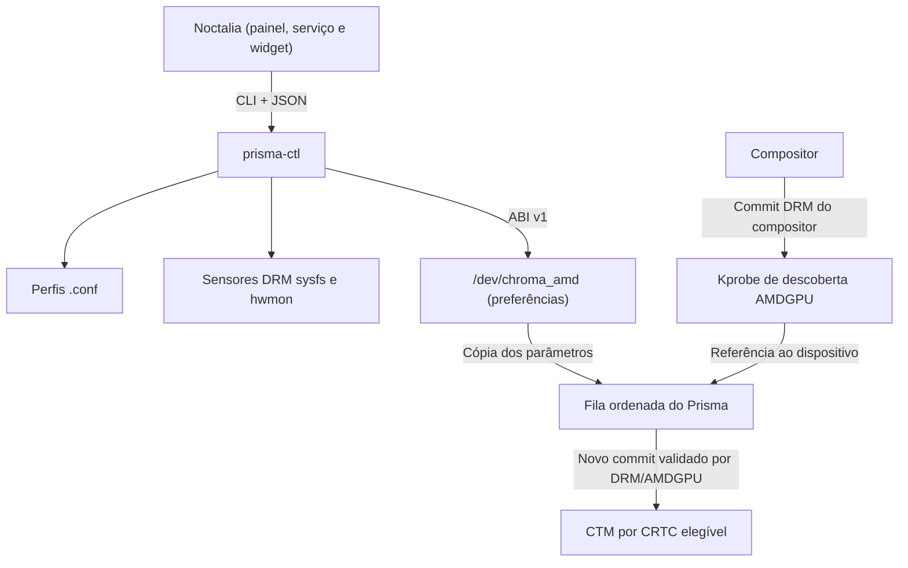

# Arquitetura e Mapa do Sistema (prisma)

O **Prisma Control Center** (`chroma-layer` / `prism-amd`) é uma suíte integrada de controle de cor e exibição em hardware projetada para GPUs AMD Radeon (`amdgpu`) no Linux, com foco no ambiente **Noctalia Shell (Niri / Wayland)**.

Este documento detalha as três camadas do sistema, o inventário completo de arquivos do repositório, o contrato oficial de integração JSON e o roteiro de evolução técnica.

---

## 1. Camadas do Sistema



### 1.1. Camada de kernel

O subsistema de kernel (`kernel/chroma_amd.ko`) é responsável pela aplicação atômica da calibração de cor em hardware via DRM/KMS e pelo rastreamento seguro de placas AMDGPU:
- **Descoberta Híbrida de GPUs:** Combina uma varredura PCI ativa e proativa (`chroma_scan_pci`), executada no carregamento do módulo (`insmod`) e sempre que a lista de GPUs estiver vazia, com um `kprobe` no ponto de commit do DRM (`drm_atomic_helper_commit`). A varredura PCI itera adaptadores com `PCI_VENDOR_ID_ATI` e classe `PCI_BASE_CLASS_DISPLAY`, obtém o `struct drm_device` via `pci_get_drvdata(pdev)` sob `device_lock`, valida o registro do driver `"amdgpu"` e enfileira o dispositivo com retenção de referências do DRM (`drm_dev_get`) e do módulo (`try_module_get`). O `kprobe` é estritamente livre de `printk` para preservar contextos INT3/NMI e kernels PREEMPT_RT.
- **Preservação Inteligente de CTM Externa vs. Matriz Identidade:** Ao avaliar os CRTCs elegíveis com suporte à propriedade `ctm`, o módulo inspeciona os 9 coeficientes em ponto fixo DRM S31.32 (`chroma_is_identity_ctm`). No formato DRM sinal-magnitude, o módulo valida se a diagonal contém `1ULL << 32` e se os elementos fora da diagonal são estritamente nulos (`(val & ~(1ULL << 63)) == 0ULL`, tratando corretamente `-0.0` com bit de sinal). Se o CRTC estiver sem CTM ou possuir a matriz identidade padrão aplicada pelo compositor Wayland (Smithay/Niri), o Prisma assume o CRTC (`adopting CRTC`). Se o compositor tiver aplicado uma matriz externa de cor ativa (como Night Light / ICC), o Prisma cede o CRTC e não interfere.
- **Fallback Automático de Modeset para DCN 2.x:** Em hardware AMD DCN 2.1 (ex.: APUs Cezanne/Vega), o driver `amdgpu_dm` exige `allow_modeset = true` durante a transição inicial de vinculação (`!*owned`) ou remoção (`!target`) da matriz CTM para recalcular blocos de cor DPP/MPC, rejeitando o fast path com `-EINVAL`. O módulo tenta primeiramente o fast path `state->allow_modeset = false` (evitando flicker em ajustes contínuos de slider) e, se receber `-EINVAL` durante uma transição, efetua uma nova tentativa atômica controlada com `state->allow_modeset = true`.
- **Tratamento de Contenção `-EBUSY`:** Caso o commit atômico conflite com um pageflip em andamento do compositor retornando `-EBUSY`, a fila ordenada reagenda a execução de forma assíncrona com limite seguro (`CHROMA_MAX_BUSY_RETRIES = 5`) para evitar perda de comando e loops infinitos.

O dispositivo de caractere usa ABI v1 com leitura textual, `GET_ABI`, `GET_STATE` e `SET_STATE`. Escritas textuais parciais preservam os campos omitidos e são validadas integralmente sob o mutex de configuração. As leituras por ioctl recebem uma única cópia coerente. Sysfs expõe os campos individuais em modo de leitura em `/sys/kernel/chroma_amd/`.

Ao desativar ou usar parâmetros neutros, o workqueue restaura bypass somente nos CRTCs em que a referência instalada ainda é a CTM atual. Quando detecta outro blob, libera a referência antiga. Um timer agenda a reavaliação dos dispositivos conhecidos a cada dois segundos para lidar com mudanças de propriedade, atividade da saída, falhas transitórias e remoção. `drm_dev_enter()` protege as operações durante remoção do AMDGPU. A fila pausa antes da suspensão e retoma após o evento de PM. O descarregamento retira a sonda, sincroniza o IRQ work, cancela a fila, restaura as saídas para bypass e libera as referências.

### 1.2. Camada 2: Userspace CLI & Telemetria (`src/cli/`)

A interface de controle de usuário é construída em C++20 com quatro responsabilidades.
- **`device.cpp` / `device.hpp`:** Gerencia a comunicação de baixo nível com `/dev/chroma_amd` via chamadas de sistema POSIX (`open`, `read`, `write`, `close`). Expõe `is_device_available()` e `try_read_device_state()`, permitindo checar a presença do módulo sem falhas abruptas. Valida intervalos de parâmetros no cliente antes do envio e traduz códigos de erro do sistema (`ENOENT` para módulo descarregado, `EACCES` para permissão do grupo `video`, `EINVAL` para parâmetro rejeitado).
- **`telemetry.cpp` / `telemetry.hpp`:** Realiza a descoberta dinâmica de adaptadores gráficos AMD varrendo `/sys/class/drm/card*/device/vendor` em busca de `0x1002` (sem hardcodar índices como `card0` ou `card1`). Desacoplada totalmente do nó `/dev/chroma_amd`, operando mesmo se o módulo de kernel não estiver carregado. Detecta dinamicamente modelos de GPU (incluindo Radeon RX 9060 XT via PCI ID `0x7590`), categoriza dGPU vs. APU, lê dados de carga (`gpu_busy_percent`), memória VRAM e GTT, frequência ativa de SCLK, temperaturas de encapsulamento/hotspot e potência em Watts.
- **`profiles.cpp` / `profiles.hpp`:** Usa arquivos regulares `<nome>.conf` no diretório de perfis configurado. Valida o nome e os parâmetros, navega por descritores de diretório sem seguir links e publica gravações com rename e fsync. A CLI oferece salvamento, aplicação, listagem, exclusão e restauração de padrões.
- **`main.cpp`:** CLI `prisma-ctl` oferecendo os subcomandos `status`, `set`, `telemetry` e `profile`. Suporta saída em texto legível para humanos e formato JSON estruturado (`--json`) com o campo `device.available` que desacopla a presença da GPU do módulo de calibração.

### 1.3. Camada 3: Plugin Noctalia Shell (`ui/prisma/`)

Interface gráfica oficial integrada ao Noctalia Shell no compositor Niri:
- **`plugin.toml`:** Manifesto do plugin com metadados, configurações do usuário (métrica da barra e ocultação quando inativo), declaração do serviço em background, do widget de barra e do painel flutuante.
- **`prisma_service.luau`:** Serviço persistente que monitora o estado do hardware e despacha comandos assíncronos (`prisma-ctl status --json`, `prisma-ctl set`, `prisma-ctl profile`). Implementa pooling adaptativo (1000ms com painel aberto, 2000ms em repouso) e debounce de 40ms para comandos interativos. Publica atualizações de forma otimista (`currentDev = if isDirty or isMutating then pendingState else deviceState`) e protege o estado contra snapshots de hardware obsoletos em trânsito.
- **`prisma_widget.luau`:** Widget exibido na barra do Noctalia Shell com o ícone de paleta, métrica selecionada (Hotspot, Borda ou Carga) e tooltip com resumo de sensores. Em APUs sem sensor Hotspot (`temp_junction_c`), adota fallback automático para a temperatura de encapsulamento (`temp_edge_c`).
- **`prisma_panel.luau`:** Central de controle interativa estruturada em 3 abas com imunidade a *snap-back* de sliders:
  - **Desempenho:** Indicadores proporcionais com escala dinâmica inteligente:
    - *APUs (ex.: Ryzen 5 5600GT):* Teto de potência ajustado para 65W (PPT), exibição unificada de memória `VRAM + GTT` (ex.: 512 MiB VRAM + GTT do sistema) e fallback limpo para sensor único de borda.
    - *dGPUs (ex.: RX 9060 XT):* Teto de potência de 300W, alocação de memória VRAM dedicada física e exibição simultânea de Hotspot e Borda.
  - **Tela & Cor:** Chave mestre de calibragem, trackbars interativas de 25 segmentos clicáveis para Saturação, Contraste e Brilho, campo de entrada numérica direta (`width = 64`), botões de ajuste fino (`-1`/`+1`), restauração individual e presets rápidos (Padrão, Competitivo, Cinema e Monocromático). Mantém `hasPendingColorUpdate` para reter o valor clicado localmente até confirmação do driver.
  - **Perfis:** Formulário de salvamento do estado atual, listagem de perfis salvos com ações de aplicar/remover e restauração aos padrões de fábrica.

> [!NOTE]
> **Arquitetura de execução do plugin Noctalia Shell (API 36):** O runtime do Noctalia carrega cada componente (`service`, `widget`, `panel`) em instâncias isoladas a partir de seus arquivos de entrada declarados em `plugin.toml`, sem suporte a `require()` relativo entre módulos locais dentro do diretório do plugin. Por essa razão, `prisma_panel.luau` é mantido como uma unidade coesa, estruturada em funções e helpers modulares internos, prevenindo falhas de resolução dinâmica em produção.

---

## 2. Inventário de Arquivos do Repositório

| Arquivo / Diretório | Responsabilidade Única |
| :--- | :--- |
| `kernel/chroma_main.c` | Ponto de entrada do módulo de kernel (`module_init`/`module_exit`), estado/configuração global, workqueue, timer de rechecagem e PM suspend/resume notifier. |
| `kernel/chroma_ctm.c` | Cálculo da matriz CTM Rec.709 (saturação, contraste, brilho), conversão em ponto fixo DRM S31.32 e detecção de matriz identidade. |
| `kernel/chroma_drm.c` | Varredura PCI proativa, fila de descoberta, hook Kprobe em `drm_atomic_helper_commit`, commits atômicos DRM/KMS e ciclo de vida de GPUs. |
| `kernel/chroma_iface.c` | Dispositivo de caractere `/dev/chroma_amd` (`read`/`write`/`ioctl`), parser textual de configuração e atributos sysfs em `/sys/kernel/chroma_amd/`. |
| `kernel/chroma_internal.h` | Cabeçalho interno com definições de estruturas (`chroma_gpu`), sincronização e protótipos compartilhados do módulo. |
| `kernel/Makefile` | Automação de compilação Kbuild (`chroma_amd.ko` a partir dos 4 objetos modulares), detecção de `LLVM=1`, carga e descarga. |
| `kernel/70-chroma-amd.rules` | Regra devtmpfs atribuindo o dispositivo `/dev/chroma_amd` ao grupo `video` com permissões `0660`. |
| `kernel/dkms.conf` | Metadados do DKMS para compilação automática do módulo a cada atualização do kernel Linux. |
| `src/cli/device.hpp` / `device.cpp` | Controlador POSIX I/O para `/dev/chroma_amd`, validação de limites de parâmetros e tratamento detalhado de erros do sistema. |
| `src/cli/telemetry.hpp` / `telemetry.cpp` | Descoberta dinâmica de GPU AMD (`vendor == 0x1002`), leitura de métricas sysfs e hwmon e formatadores texto/JSON. |
| `src/cli/profiles.hpp` / `profiles.cpp` | Serialização, carregamento, listagem e exclusão de perfis INI em `~/.config/prisma/profiles/`. |
| `src/cli/main.cpp` | Ponto de entrada do executável `prisma-ctl`, despachando `status`, `set`, `telemetry`, `profile`, `doctor` e as opções de versão e ajuda. |
| `legacy/` | Componentes históricos opcionais: hook DRM via `LD_PRELOAD` (`drm_hook.cpp`, `drm_ctm.cpp`), camada Vulkan (`layer.cpp`, `shader.comp`), manifesto e exemplo de configuração. |
| `tests/test_ctm.cpp` | Testes unitários de validação matemática do ponto fixo S31.32 e saturação Rec.709. |
| `tests/test_cli.cpp` | Testes unitários do parser de dispositivo, validação de limites, telemetria mockada e gerenciador de perfis. |
| `ui/prisma/plugin.toml` | Manifesto do plugin oficial para Noctalia Shell. |
| `ui/prisma/prisma_service.luau` | Daemon de integração Luau para consulta de status e despacho de comandos. |
| `ui/prisma/prisma_widget.luau` | Indicador visual para a barra do Noctalia Shell. |
| `ui/prisma/prisma_panel.luau` | Painel gráfico completo do Prisma Control Center em Luau nativo. |
| `ui/prisma/translations/` | Arquivos de localização (pt-BR e en) para o plugin do Noctalia. |
| `CMakeLists.txt` | Configuração principal do CMake para os binários da CLI, testes unitários e alvos de instalação (`install-local`, `install-ui`). |

---

## 3. Contrato Oficial de Integração (`prisma-ctl status --json`)

O comando `prisma-ctl status --json` emite um objeto JSON no stdout com a seguinte estrutura padronizada:

```json
{
  "device": {
    "enabled": 1,
    "saturation": 160,
    "contrast": 115,
    "brightness": 10
  },
  "telemetry": {
    "card": "card1",
    "pci_id": "0000:2d:00.0",
    "device_id": "1002:7590",
    "is_apu": false,
    "gpu_busy_percent": 7,
    "sclk_mhz": 964,
    "vram_used_mib": 1304.5,
    "vram_total_mib": 16304.0,
    "gtt_used_mib": 412.0,
    "gtt_total_mib": 16000.0,
    "temp_edge_c": 41.0,
    "temp_junction_c": 43.0,
    "power_watts": 22.0
  }
}
```

### 3.1. Especificação dos Campos

#### Objeto `device`

| Campo | Tipo | Faixa Válida | Padrão | Unidade / Significado |
| :--- | :--- | :--- | :--- | :--- |
| `enabled` | Inteiro | `0` ou `1` | `1` | Configuração desejada: `1` habilita a CTM do Prisma em saídas elegíveis. `0` remove CTMs pertencentes ao Prisma. |
| `saturation` | Inteiro | `0` a `400` | `100` | Fator de saturação Rec.709. `100` = saturação normal (1.0x); `200` = dobro (2.0x); `0` = monocromático. |
| `contrast` | Inteiro | `10` a `300` | `100` | Fator de contraste linear. `100` = normal; `115` = +15%; `90` = -10%. |
| `brightness` | Inteiro | `-100` a `100` | `0` | Ganho de luminância linear proporcional na CTM (0.25x a 1.75x). `0` = ganho 1.0x (neutro). |

#### Objeto `telemetry`

| Campo | Tipo | Formato / Valores | Significado |
| :--- | :--- | :--- | :--- |
| `card` | String \| null | `"card0"`, `"card1"` | Nome do nó do dispositivo no DRM (`/sys/class/drm/`). |
| `pci_id` | String \| null | `"0000:2d:00.0"` | Identificador do slot PCI no barramento do sistema. |
| `device_id` | String \| null | `"1002:7590"` | Identificador de fornecedor e dispositivo PCI da GPU AMD. |
| `is_apu` | Booleano | `true` ou `false` | Indica se o hardware é uma APU (GPU integrada com memória compartilhada). |
| `gpu_busy_percent` | Inteiro \| null | `0` a `100` | Porcentagem instantânea de utilização dos compute engines da GPU. |
| `sclk_mhz` | Inteiro \| null | Inteiro em MHz | Frequência de clock ativa do chip gráfico (extraída de `pp_dpm_sclk`). |
| `vram_used_mib` | Float \| null | Flutuante (MiB) | Quantidade de memória VRAM atualmente alocada pelo driver. |
| `vram_total_mib` | Float \| null | Flutuante (MiB) | Capacidade total de memória VRAM física disponível na GPU. |
| `gtt_used_mib` | Float \| null | Flutuante (MiB) | Quantidade de memória do sistema (GTT) atualmente alocada para gráficos. |
| `gtt_total_mib` | Float \| null | Flutuante (MiB) | Capacidade total de memória do sistema alocável para a GPU via GTT. |
| `temp_edge_c` | Float \| null | Flutuante (°C) | Temperatura do sensor de borda (`edge`) do encapsulamento da GPU. |
| `temp_junction_c` | Float \| null | Flutuante (°C) | Temperatura do ponto mais quente da matriz de silício (`junction` / Hotspot). |
| `power_watts` | Float \| null | Flutuante (W) | Consumo elétrico instantâneo em Watts reportado pelo sensor do regulador. |

*Regra de Robustez:* Sempre que um sensor não estiver disponível no hardware ou a versão do driver não expuser o arquivo correspondente, o valor será retornado como `null` literal. Com o módulo presente e sem GPU identificada, `card` e os sensores também são `null`. Com o módulo ausente, `status` retorna erro e `telemetry` continua disponível.

---

## 4. Compilação e testes

O CMake padrão constrói a CLI e os testes de userspace (`test_cli` e `check_ui`). Os caminhos históricos em `legacy/layer.cpp` e `legacy/drm_hook.cpp` têm opções de compilação independentes, descritas no README. O PKGBUILD instala a CLI, a fonte DKMS, a regra udev e os arquivos do plugin. `tests/test_kernel_abi.cpp` cobre o dispositivo real em uma VM. Os testes de CTM em VKMS usam um módulo de teste e um driver virtual configurado para expor a propriedade.

### Suíte de Testes Comportamentais da UI Luau (`tests/test_ui.luau`)

Integrada ao CTest através de `tests/check_ui.py`, a suíte executa os scripts reais `prisma_service.luau`, `prisma_widget.luau` e `prisma_panel.luau` em uma máquina virtual Luau determinística com mocks completos do runtime Noctalia (`noctalia`, `ui`, `barWidget`, `panel`):
- **Cenário 1 (APU Ryzen 5 5600GT):** Valida fallback de temperatura Borda quando Hotspot é nulo, soma unificada `VRAM + GTT`, teto de potência 65W e rótulos de hardware.
- **Cenário 2 (dGPU RX 9060 XT):** Valida leitura de Hotspot, teto de 300W e exibição de VRAM física dedicada.
- **Cenário 3 (Hardware Offline):** Valida ocultação do widget quando `hide_inactive = true` e desativação segura dos indicadores.
- **Cenário 4 (Ajuste Otimista de Cor e Imunidade a Snapshots Obsoletos):** Valida atualização imediata do slider para 150%, retenção de comando em trânsito assíncrono, imunidade contra *snap-back* diante de polls com snapshots obsoletos e reconciliação limpa pós-hardware.

## 5. Evolução

Uma frente futura é o daemon de perfis por jogo, com detecção da janela ativa e aplicação ou restauração de perfis ao iniciar ou encerrar aplicativos.
