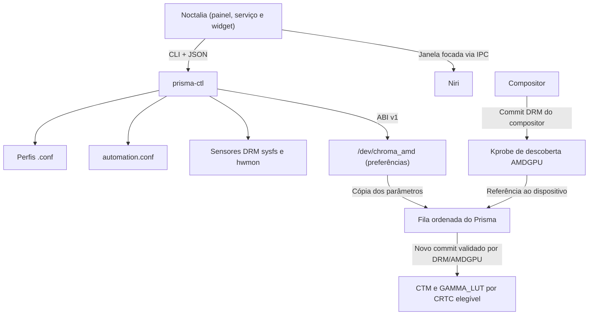

# Arquitetura e Mapa do Sistema (prisma)

O **Prisma Control Center** (`chroma-layer` / `prism-amd`) é uma suíte integrada de controle de cor e exibição em hardware projetada para GPUs AMD Radeon (`amdgpu`) no Linux, com foco no ambiente **Noctalia Shell (Niri / Wayland)**.

Este documento descreve as três camadas do sistema, os arquivos do repositório e os contratos JSON de integração.

---

## 1. Camadas do Sistema



### 1.1. Camada de kernel

O subsistema de kernel (`kernel/chroma_amd.ko`) é responsável pela aplicação atômica da calibração de cor em hardware via DRM/KMS e pelo rastreamento seguro de placas AMDGPU:
- **Descoberta Híbrida de GPUs:** Combina uma varredura PCI ativa e proativa (`chroma_scan_pci`), executada no carregamento do módulo (`insmod`) e sempre que a lista de GPUs estiver vazia, com um `kprobe` no ponto de commit do DRM (`drm_atomic_helper_commit`). A varredura PCI itera adaptadores com `PCI_VENDOR_ID_ATI` e classe `PCI_BASE_CLASS_DISPLAY`, obtém o `struct drm_device` via `pci_get_drvdata(pdev)` sob `device_lock`, valida o registro do driver `"amdgpu"` e enfileira o dispositivo com retenção de referências do DRM (`drm_dev_get`) e do módulo (`try_module_get`). O `kprobe` é estritamente livre de `printk` para preservar contextos INT3/NMI e kernels PREEMPT_RT.
- **Separação do Pipeline de Cor (CTM + GAMMA_LUT):** O DRM/KMS organiza o pipeline de cor sequencialmente em `DEGAMMA_LUT` → `CTM` → `GAMMA_LUT`. O Prisma dedica a matriz CTM (3x3) exclusivamente ao controle de **Saturação Rec.709** (`0..400`) e a tabela 1D `GAMMA_LUT` ao controle de **Contraste** (`10..300`, com pivô central no cinza médio 0.5) e **Brilho** (offset linear limitado a `±50%`). Ambas as propriedades são calculadas em aritmética inteira de 64 bits sem ponto flutuante (zero FPU).
- **Rastreamento Independente e Coexistência com Night Light:** Cada CRTC possui rastreamento independente para CTM e GAMMA_LUT (`struct chroma_crtc_owned`). O módulo inspeciona independentemente a CTM (`chroma_is_identity_ctm`) e a GAMMA_LUT (`chroma_is_identity_gamma_lut` com tolerância `±1` em R/G/B). Caso uma propriedade contenha calibragem externa ativa (como Night Light / wlsunset / ICC na GAMMA_LUT), o Prisma cede exclusivamente a propriedade conflitante e continua gerenciando a outra (permitindo saturação calibrada concomitantemente com Night Light ativo). Se a propriedade externa retornar à identidade, o Prisma retoma o controle no próximo ciclo.
- **Suporte Dinâmico a 4096 Entradas e Alocação Segura:** O tamanho da tabela GAMMA_LUT é lido dinamicamente da propriedade atômica `gamma_lut_size_property` (4096 entradas nos DCNs modernos da AMDGPU, evitando o limite legado de 256 de `crtc->gamma_size`). O buffer de 32 KiB é alocado dinamicamente fora da pilha do kernel via `kvmalloc_array` / `kvfree`.
- **Fallback Automático de Modeset para DCN 2.x:** Em hardware AMD DCN 2.1 (ex.: APUs Cezanne/Vega), o driver `amdgpu_dm` exige `allow_modeset = true` durante a transição inicial de vinculação (`!*owned`) ou remoção (`!target`) de CTM e GAMMA_LUT para recalcular blocos de cor DPP/MPC, rejeitando o fast path com `-EINVAL`. O módulo tenta primeiramente o fast path `state->allow_modeset = false` (evitando flicker em ajustes contínuos de slider) e, se receber `-EINVAL` durante uma transição, efetua uma nova tentativa atômica controlada com `state->allow_modeset = true`.
- **Tratamento de Contenção `-EBUSY`:** Caso o commit atômico conflite com um pageflip em andamento do compositor retornando `-EBUSY`, a fila ordenada reagenda a execução de forma assíncrona com limite seguro (`CHROMA_MAX_BUSY_RETRIES = 5`) para evitar perda de comando e loops infinitos.

O dispositivo de caractere usa ABI v1 com leitura textual, `GET_ABI`, `GET_STATE` e `SET_STATE`. Escritas textuais parciais preservam os campos omitidos e são validadas integralmente sob o mutex de configuração. As leituras por ioctl recebem uma única cópia coerente. Sysfs expõe os campos individuais em modo de leitura em `/sys/kernel/chroma_amd/`.

Ao desativar ou usar parâmetros neutros, o workqueue restaura bypass somente nos CRTCs em que a referência instalada ainda é a propriedade atual. Quando detecta outro blob, libera a referência antiga. Um timer agenda a reavaliação dos dispositivos conhecidos a cada dois segundos para lidar com mudanças de propriedade, atividade da saída, falhas transitórias e remoção. `drm_dev_enter()` protege as operações durante remoção do AMDGPU. A fila pausa antes da suspensão e retoma após o evento de PM. O descarregamento retira a sonda, sincroniza o IRQ work, cancela a fila, restaura as saídas para bypass e libera as referências.

### 1.2. Camada 2: Userspace CLI & Telemetria (`src/cli/`)

A interface de controle de usuário é construída em C++20 com quatro responsabilidades.
- **`device.cpp` / `device.hpp`:** Gerencia a comunicação de baixo nível com `/dev/chroma_amd` via chamadas de sistema POSIX (`open`, `read`, `write`, `close`). Expõe `is_device_available()` e `try_read_device_state()`, permitindo checar a presença do módulo sem falhas abruptas. Valida intervalos de parâmetros no cliente antes do envio e traduz códigos de erro do sistema (`ENOENT` para módulo descarregado, `EACCES` para permissão do grupo `video`, `EINVAL` para parâmetro rejeitado).
- **`telemetry.cpp` / `telemetry.hpp`:** Realiza a descoberta dinâmica de adaptadores gráficos AMD varrendo `/sys/class/drm/card*/device/vendor` em busca de `0x1002` (sem hardcodar índices como `card0` ou `card1`). Desacoplada totalmente do nó `/dev/chroma_amd`, operando mesmo se o módulo de kernel não estiver carregado. Detecta dinamicamente modelos de GPU (incluindo Radeon RX 9060 XT via PCI ID `0x7590`), categoriza dGPU vs. APU, lê dados de carga (`gpu_busy_percent`), memória VRAM e GTT, frequência ativa de SCLK, temperaturas de encapsulamento/hotspot e potência em Watts.
- **`profiles.cpp` / `profiles.hpp`:** Persiste perfis e regras de automação em arquivos regulares. Valida nomes e valores, navega por descritores de diretório sem seguir links e grava usando arquivo temporário, `fsync` e `rename`.
- **`main.cpp`:** CLI `prisma-ctl` com os subcomandos `status`, `set`, `telemetry`, `profile`, `rule` e `doctor`. O campo `device.available` em `status --json` indica a disponibilidade do módulo de calibração independentemente da telemetria da GPU.

### 1.3. Camada 3: Plugin Noctalia Shell (`ui/prisma/`)

Interface gráfica oficial integrada ao Noctalia Shell no compositor Niri:
- **`plugin.toml`:** Manifesto do plugin com metadados, configurações do usuário (métrica da barra e ocultação quando inativo), declaração do serviço em background, do widget de barra e do painel flutuante.
- **`prisma_service.luau`:** Serviço persistente que monitora o estado do hardware, restaura o perfil padrão e consulta o foco do Niri. Consulta o estado do hardware a cada segundo com o painel aberto e a cada cinco segundos em repouso. Aplica um debounce de 50 ms a comandos interativos e publica as alterações de forma otimista enquanto aguarda a confirmação.
- **`prisma_widget.luau`:** Widget exibido na barra do Noctalia Shell com o ícone de paleta, métrica selecionada (Hotspot, Borda ou Carga) e tooltip com resumo de sensores. Em APUs sem sensor Hotspot (`temp_junction_c`), adota fallback automático para a temperatura de encapsulamento (`temp_edge_c`).
- **`prisma_panel.luau`:** Central de controle interativa estruturada em 3 abas com imunidade a *snap-back* de sliders:
  - **Desempenho:** Indicadores proporcionais com escala dinâmica inteligente:
    - *APUs (ex.: Ryzen 5 5600GT):* Teto de potência ajustado para 65W (PPT), exibição unificada de memória `VRAM + GTT` (ex.: 512 MiB VRAM + GTT do sistema) e fallback limpo para sensor único de borda.
    - *dGPUs (ex.: RX 9060 XT):* Teto de potência de 300W, alocação de memória VRAM dedicada física e exibição simultânea de Hotspot e Borda.
  - **Tela & Cor:** Chave mestre de calibragem, trackbars interativas de 25 segmentos clicáveis para Saturação, Contraste e Brilho, campo de entrada numérica direta (`width = 64`), botões de ajuste fino (`-1`/`+1`), restauração individual e presets rápidos (Padrão, Competitivo, Cinema e Monocromático). Mantém `hasPendingColorUpdate` para reter o valor clicado localmente até confirmação do driver.
  - **Perfis:** Salvamento, aplicação e exclusão de perfis, escolha do padrão de inicialização, gerenciamento de regras do Niri e restauração aos padrões de fábrica.

> [!NOTE]
> **Arquitetura de execução do plugin Noctalia Shell (API 36):** O runtime do Noctalia carrega cada componente (`service`, `widget`, `panel`) em instâncias isoladas a partir de seus arquivos de entrada declarados em `plugin.toml`, sem suporte a `require()` relativo entre módulos locais dentro do diretório do plugin. Por essa razão, `prisma_panel.luau` é mantido como uma unidade coesa, estruturada em funções e helpers modulares internos, prevenindo falhas de resolução dinâmica em produção.

---

## 2. Inventário de Arquivos do Repositório

| Arquivo / Diretório | Responsabilidade Única |
| :--- | :--- |
| `kernel/chroma_main.c` | Ponto de entrada do módulo de kernel (`module_init`/`module_exit`), estado/configuração global, workqueue, timer de rechecagem e PM suspend/resume notifier. |
| `kernel/chroma_ctm.c` | Cálculo da matriz CTM Rec.709 (saturação) e da tabela 1D GAMMA_LUT (contraste e brilho), conversão em ponto fixo DRM S31.32 e detecção de matriz identidade e curva de gama neutra. |
| `kernel/chroma_drm.c` | Varredura PCI proativa, fila de descoberta, hook Kprobe em `drm_atomic_helper_commit`, commits atômicos DRM/KMS e ciclo de vida de GPUs. |
| `kernel/chroma_iface.c` | Dispositivo de caractere `/dev/chroma_amd` (`read`/`write`/`ioctl`), parser textual de configuração e atributos sysfs em `/sys/kernel/chroma_amd/`. |
| `kernel/chroma_internal.h` | Cabeçalho interno com definições de estruturas (`chroma_gpu`, `chroma_crtc_owned`), sincronização e protótipos compartilhados do módulo. |
| `kernel/Makefile` | Automação de compilação Kbuild (`chroma_amd.ko` a partir dos 4 objetos modulares), detecção de `LLVM=1`, carga e descarga. |
| `kernel/70-chroma-amd.rules` | Regra devtmpfs atribuindo o dispositivo `/dev/chroma_amd` ao grupo `video` com permissões `0660`. |
| `kernel/dkms.conf` | Metadados do DKMS para compilação automática do módulo a cada atualização do kernel Linux. |
| `src/cli/device.hpp` / `device.cpp` | Controlador POSIX I/O para `/dev/chroma_amd`, validação de limites de parâmetros e tratamento detalhado de erros do sistema. |
| `src/cli/telemetry.hpp` / `telemetry.cpp` | Descoberta dinâmica de GPU AMD (`vendor == 0x1002`), leitura de métricas sysfs e hwmon e formatadores texto/JSON. |
| `src/cli/profiles.hpp` / `profiles.cpp` | Persistência de perfis e configuração da automação no diretório do Prisma. |
| `src/cli/main.cpp` | Ponto de entrada do executável `prisma-ctl`, despachando `status`, `set`, `telemetry`, `profile`, `rule`, `doctor` e as opções de versão e ajuda. |
| `legacy/` | Componentes históricos opcionais: hook DRM via `LD_PRELOAD` (`drm_hook.cpp`, `drm_ctm.cpp`), camada Vulkan (`layer.cpp`, `shader.comp`), manifesto e exemplo de configuração. |
| `tests/test_ctm.cpp` | Testes unitários de validação matemática do ponto fixo S31.32 e saturação Rec.709. |
| `tests/test_color_math.cpp` | Testes unitários de validação matemática do ponto fixo S31.32, CTM, GAMMA_LUT, pivô de contraste, brilho e tolerância/rejeição de Night Light. |
| `tests/test_cli.cpp` | Testes unitários do parser de dispositivo, validação de limites, telemetria mockada e gerenciador de perfis. |
| `ui/prisma/plugin.toml` | Manifesto do plugin oficial para Noctalia Shell. |
| `ui/prisma/prisma_service.luau` | Daemon de integração Luau para consulta de status e despacho de comandos. |
| `ui/prisma/prisma_widget.luau` | Indicador visual para a barra do Noctalia Shell. |
| `ui/prisma/prisma_panel.luau` | Painel gráfico completo do Prisma Control Center em Luau nativo. |
| `ui/prisma/translations/` | Arquivos de localização (pt-BR e en) para o plugin do Noctalia. |
| `CMakeLists.txt` | Configuração principal do CMake para os binários da CLI, testes unitários e alvos de instalação (`install-local`, `install-ui`). |

---

## 3. Contrato Oficial de Integração (`prisma-ctl status --json`)

O comando `prisma-ctl status --json` emite um objeto JSON no stdout com a seguinte estrutura padronizada:

```json
{
  "device": {
    "enabled": 1,
    "saturation": 160,
    "contrast": 115,
    "brightness": 10
  },
  "telemetry": {
    "card": "card1",
    "pci_id": "0000:2d:00.0",
    "device_id": "1002:7590",
    "is_apu": false,
    "gpu_busy_percent": 7,
    "sclk_mhz": 964,
    "vram_used_mib": 1304.5,
    "vram_total_mib": 16304.0,
    "gtt_used_mib": 412.0,
    "gtt_total_mib": 16000.0,
    "temp_edge_c": 41.0,
    "temp_junction_c": 43.0,
    "power_watts": 22.0,
    "power_cap_watts": 180.0
  }
}
```

### 3.1. Especificação dos Campos

#### Objeto `device`

| Campo | Tipo | Faixa Válida | Padrão | Unidade / Significado |
| :--- | :--- | :--- | :--- | :--- |
| `enabled` | Inteiro | `0` ou `1` | `1` | Configuração desejada: `1` habilita a CTM do Prisma em saídas elegíveis. `0` remove CTMs pertencentes ao Prisma. |
| `saturation` | Inteiro | `0` a `400` | `100` | Fator de saturação Rec.709. `100` = saturação normal (1.0x); `200` = dobro (2.0x); `0` = monocromático. |
| `contrast` | Inteiro | `10` a `300` | `100` | Fator de contraste linear. `100` = normal; `115` = +15%; `90` = -10%. |
| `brightness` | Inteiro | `-100` a `100` | `0` | Ganho de luminância linear proporcional na CTM (0.25x a 1.75x). `0` = ganho 1.0x (neutro). |

#### Objeto `telemetry`

| Campo | Tipo | Formato / Valores | Significado |
| :--- | :--- | :--- | :--- |
| `card` | String \| null | `"card0"`, `"card1"` | Nome do nó do dispositivo no DRM (`/sys/class/drm/`). |
| `pci_id` | String \| null | `"0000:2d:00.0"` | Identificador do slot PCI no barramento do sistema. |
| `device_id` | String \| null | `"1002:7590"` | Identificador de fornecedor e dispositivo PCI da GPU AMD. |
| `is_apu` | Booleano | `true` ou `false` | Indica se o hardware é uma APU (GPU integrada com memória compartilhada). |
| `gpu_busy_percent` | Inteiro \| null | `0` a `100` | Porcentagem instantânea de utilização dos compute engines da GPU. |
| `sclk_mhz` | Inteiro \| null | Inteiro em MHz | Frequência de clock ativa do chip gráfico (extraída de `pp_dpm_sclk`). |
| `vram_used_mib` | Float \| null | Flutuante (MiB) | Quantidade de memória VRAM atualmente alocada pelo driver. |
| `vram_total_mib` | Float \| null | Flutuante (MiB) | Capacidade total de memória VRAM física disponível na GPU. |
| `gtt_used_mib` | Float \| null | Flutuante (MiB) | Quantidade de memória do sistema (GTT) atualmente alocada para gráficos. |
| `gtt_total_mib` | Float \| null | Flutuante (MiB) | Capacidade total de memória do sistema alocável para a GPU via GTT. |
| `temp_edge_c` | Float \| null | Flutuante (°C) | Temperatura do sensor de borda (`edge`) do encapsulamento da GPU. |
| `temp_junction_c` | Float \| null | Flutuante (°C) | Temperatura do ponto mais quente da matriz de silício (`junction` / Hotspot). |
| `power_watts` | Float \| null | Flutuante (W) | Consumo elétrico instantâneo em Watts reportado pelo sensor do regulador. |
| `power_cap_watts` | Float \| null | Flutuante (W) | Limite máximo de potência elétrica configurado para o pacote/placa (`power1_cap` ou fallback `power1_cap_default`). |

*Regra de Robustez:* Sempre que um sensor não estiver disponível no hardware ou a versão do driver não expuser o arquivo correspondente, o valor será retornado como `null` literal. Com o módulo presente e sem GPU identificada, `card` e os sensores também são `null`. Com o módulo ausente, `status` retorna erro e `telemetry` continua disponível.

#### Classificação de Hardware (APU vs. dGPU)

A CLI identifica o tipo de dispositivo combinando uma tabela estática de PCI IDs conhecidos com uma heurística baseada em múltiplos sinais do sysfs/hwmon:
1. **Tabela Estática:** Dispositivos catalogados (famílias Raven, Renoir, Cezanne, Van Gogh, Rembrandt, Raphael, Phoenix, Hawk Point, Strix Point, Polaris, Vega, RDNA 1/2/3/4) são mapeados diretamente para seu modelo, tipo e flag `is_apu`.
2. **Heurística de Múltiplos Sinais (PCI ID não catalogado):**
   - **Sinais fortes de dGPU:** Presença de sensor de temperatura de memória VRAM (`mem`/`vram`), presença de controle de ventoinha (`pwm1` ou `fan1_input`), teto de potência `power_cap_watts > 95 W`, ou alocação onde `vram_total_mib > gtt_total_mib`.
   - **Sinais de APU (na ausência de sinais fortes de dGPU):** Memória unificada compartilhada (`vram_total_mib <= 8192 MiB` com `gtt_total_mib > vram_total_mib`) sem sensores de `junction`/`mem` nem ventoinha, ou `power_cap_watts <= 65 W` com `gtt_total_mib >= vram_total_mib`.

### 3.2. Perfis salvos

`prisma-ctl profile list --json` escreve em stdout um array ordenado por nome (ordem lexicográfica de bytes), ou `[]` quando vazio. Cada objeto contém o nome do perfil em UTF-8 e os quatro parâmetros inteiros com as faixas do objeto `device`. A listagem JSON omite nomes de arquivo inválidos em UTF-8. A listagem textual padrão continua disponível com `prisma-ctl profile list`.

```json
[{"name": "jogos", "saturation": 160, "contrast": 115, "brightness": 10, "enabled": 1}]
```

### 3.3. Regras de automação

`prisma-ctl rule list --json` escreve em stdout um objeto com `enabled` (booleano), `default_profile` (nome do perfil em UTF-8 ou `null`) e `rules` (array de objetos com `pattern` e `profile`, ambos strings). As regras são ordenadas por `pattern` em ordem lexicográfica de bytes. A configuração inicial retorna `false`, `null` e `[]`, respectivamente.

```json
{
  "enabled": true,
  "default_profile": "desktop",
  "rules": [
    {"pattern": "cs2", "profile": "competitivo"},
    {"pattern": "steam_app_*", "profile": "jogos"}
  ]
}
```

A configuração fica em `$XDG_CONFIG_HOME/prisma/automation.conf` ou em `~/.config/prisma/automation.conf`. `rule set` e `rule default` exigem um perfil salvo. A exclusão de um perfil também remove suas referências da automação.

Os padrões aceitam de 1 a 128 bytes ASCII imprimíveis, sem espaços. A CLI normaliza as letras ASCII para minúsculas. `*` aceita zero ou mais caracteres, e o restante do padrão é literal. Um padrão exato ganha de um glob. Entre globs, ganha o padrão com mais bytes literais e, em caso de empate, o primeiro em ordem lexicográfica. `rule match <app_id>` consulta as regras independentemente de `enabled` e imprime o perfil correspondente. Na ausência de correspondência, a saída fica vazia e o código de saída é `1`.

O serviço Noctalia aplica o perfil padrão uma vez ao confirmar o acesso ao dispositivo na inicialização, independentemente de `enabled`. A cada segundo, consulta a janela focada quando a automação está ativa e há regras ou quando a aba Perfis está aberta. Com o painel aberto ou uma alteração em trânsito, a troca por foco fica suspensa. Ao focar uma janela sem correspondência após uma regra, o serviço restaura o perfil padrão ou os valores que precediam a regra. Uma seleção manual feita durante uma regra prevalece até o foco mudar de janela. Desativar a troca automática preserva a calibração que estiver aplicada naquele momento.

O objeto `automation` no estado compartilhado do plugin inclui `enabled`, `default_profile` e `rules`, além de `niri_available`, `active_rule` (o padrão aplicado), `active_app_id` (o identificador da janela sob a regra) e `last_app_id` (o último identificador capturado). Uma falha no IPC do Niri interrompe as consultas em segundo plano. A próxima abertura da aba Perfis pode tentar novamente.

O serviço relê a configuração a cada dez segundos para reconhecer alterações feitas diretamente pela CLI. A aba Perfis atualiza a configuração ao abrir e após alterações feitas pelo painel.

---

## 4. Compilação e testes

O CMake padrão constrói a CLI e os testes de userspace (`test_cli` e `check_ui`). Os caminhos históricos em `legacy/layer.cpp` e `legacy/drm_hook.cpp` têm opções de compilação independentes, descritas no README. O PKGBUILD instala a CLI, a fonte DKMS, a regra udev e os arquivos do plugin. `tests/test_kernel_abi.cpp` cobre o dispositivo real em uma VM. Os testes de CTM em VKMS usam um módulo de teste e um driver virtual configurado para expor a propriedade.

### Suíte de Testes Comportamentais da UI Luau (`tests/test_ui.luau`)

Integrada ao CTest através de `tests/check_ui.py`, a suíte executa os scripts reais `prisma_service.luau`, `prisma_widget.luau` e `prisma_panel.luau` em uma máquina virtual Luau determinística com mocks completos do runtime Noctalia (`noctalia`, `ui`, `barWidget`, `panel`):
- **Cenário 1 (APU Ryzen 5 5600GT):** Valida fallback de temperatura Borda quando Hotspot é nulo, soma unificada `VRAM + GTT`, teto de potência 65W e rótulos de hardware.
- **Cenário 2 (dGPU RX 9060 XT):** Valida leitura de Hotspot, teto de 300W e exibição de VRAM física dedicada.
- **Cenário 3 (Hardware Offline):** Valida ocultação do widget quando `hide_inactive = true` e desativação segura dos indicadores.
- **Cenário 4 (Ajuste Otimista de Cor e Imunidade a Snapshots Obsoletos):** Valida atualização imediata do slider para 150%, retenção de comando em trânsito assíncrono, imunidade contra *snap-back* diante de polls com snapshots obsoletos e reconciliação limpa pós-hardware.
- **Automação de perfis:** Valida a aplicação do padrão na inicialização, as transições de foco do Niri, a pausa enquanto o painel está aberto, a indisponibilidade silenciosa do compositor e os controles da aba Perfis.
